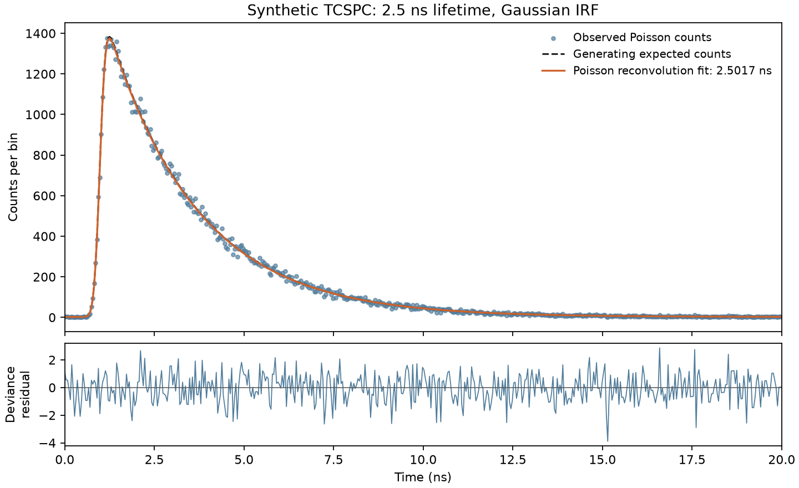

# TCSPC Lifetime Toolkit

**Scientific Python tools for simulating, fitting and evaluating fluorescence
lifetimes from time-correlated single-photon-counting (TCSPC) histograms.**

A recorded decay combines fluorescence kinetics, the instrument response
function (IRF), detector background and photon-counting noise. The toolkit makes
those assumptions explicit and compares physics-based inference with learned
estimators under controlled distribution shift and model mismatch.

For scientists, Python developers and collaborators studying when estimates can be trusted.
Reference evidence is synthetic; a canonical CSV path also supports compatible experimental measurements.

[Documentation](docs/README.md) · [Executable examples](examples/README.md) ·
[Scientific results](docs/results.md) · [API](docs/api.md) ·
[Changelog](CHANGELOG.md) · [Issues](https://github.com/moryev/tcspc-lifetime-toolkit/issues)

## Main capabilities

- Mono-, bi- and multi-exponential decay simulation with independent Poisson
  photon sampling, IRF convolution and constant detector background.
- Gaussian, exponentially modified Gaussian (EMG), and sampled/measured IRF
  sources with explicit registration, resampling and preparation diagnostics.
- Mono-exponential least-squares and Poisson reconvolution; estimation of
  lifetime, amplitude, background and temporal shift.
- Measurement validation, physical features, normalized/PCA representations,
  leakage-aware ML training and controlled external generalization benchmarks.
- Local covariance, parametric bootstrap, ML/conformal uncertainty and genuine
  Bayesian Poisson inference with explicit priors and sampling diagnostics.
- Optional SQLite recording and querying of scientific results and provenance.

## Installation

Requires **Python 3.11 or newer**. Install from a checkout to run the committed
examples and access bundled data:

```bash
git clone https://github.com/moryev/tcspc-lifetime-toolkit.git
cd tcspc-lifetime-toolkit
python -m venv .venv
```

Activate the environment on macOS/Linux:

```bash
source .venv/bin/activate
```

Or in Windows PowerShell:

```powershell
.\.venv\Scripts\Activate.ps1
```

Then install the base package:

```bash
python -m pip install -e .
```

The base dependencies include NumPy, SciPy, pandas, Matplotlib and scikit-learn.
Choose extras only as needed:

```bash
python -m pip install -e ".[dev]"           # pytest and Jupyter
python -m pip install -e ".[bayesian]"      # emcee for actual posterior sampling
python -m pip install -e ".[dev,bayesian]"  # complete development/test environment
```

## Five-minute quick start

From the checkout root:

```bash
python examples/quickstart.py
```

Or copy this complete **synthetic** workflow into Python: decay → IRF convolution
→ expected counts/background → seeded Poisson observation → reconvolution fit.

<!-- quickstart begin -->
```python
import numpy as np

from tcspc_toolkit import (
    build_expected_counts_from_irf, fit_monoexponential_reconvolution,
    generate_gaussian_irf_profile, monoexponential_decay, prepare_irf,
    sample_photon_counts,
)
from tcspc_toolkit.estimation.classical import estimate_reconvolution_initial_guess
from tcspc_toolkit.evaluation.diagnostics import calculate_poisson_deviance_residuals

time_ns = np.linspace(0.0, 20.0, 512)
lifetime_true_ns = 2.5
decay = monoexponential_decay(time_ns, amplitude=1.0, lifetime=lifetime_true_ns)
source = generate_gaussian_irf_profile(
    time_ns, gaussian_centre_ns=1.0, gaussian_fwhm_ns=0.3,
)
prepared = prepare_irf(source, time_ns)  # Explicit same-grid, unit-area kernel.
expected = build_expected_counts_from_irf(
    decay, prepared, signal_photon_count=100_000, background_per_bin=2.0,
)  # Convolve, scale the finite-window signal sum, then add background.
counts = sample_photon_counts(expected, np.random.default_rng(42))
guess = estimate_reconvolution_initial_guess(
    time=time_ns, counts=counts, irf=prepared.kernel,
)
fit = fit_monoexponential_reconvolution(
    time_ns, counts, prepared.kernel,
    initial_guess=(guess.amplitude, guess.lifetime_ns,
                   guess.background, guess.temporal_shift_ns),
    temporal_shift_bounds=(-0.5, 0.5), objective="poisson",
)
if not fit.success:
    raise RuntimeError(f"Fit did not pass numerical checks: {fit.optimizer_message}")
residuals = calculate_poisson_deviance_residuals(counts, fit.fitted_curve)
print(f"Synthetic lifetime: {lifetime_true_ns:.4f} ns; estimate: {fit.lifetime:.4f} ns")
print(f"Background: {fit.background:.3f} counts/bin; shift: {fit.temporal_shift:.5f} ns")
print(f"Numerical validation: {fit.numerical_validation_passed}")
print(f"Poisson deviance: {np.sum(residuals**2):.3f} across {counts.size} bins")
```
<!-- quickstart end -->

Typical output:

```text
Synthetic lifetime: 2.5000 ns; estimate: 2.5017 ns
Background: 2.155 counts/bin; shift: 0.00031 ns
Numerical validation: True
Poisson deviance: 543.328 across 512 bins
```

The signal budget is the **finite-window sum after convolution**, before background.
The fitted amplitude is a different scale, not the signal photon count. Background
and shift (bounded to ±0.5 ns) are fitted. Read the
[model conventions](docs/user_guide.md#simulation-and-reconvolution) before adapting it.



Regenerate this figure from the same observation and fit:

```bash
python examples/quickstart.py --figure docs/images/quickstart.png
```

This small matched-model demonstration is not a benchmark or calibration study.
A close estimate, successful optimizer or acceptable scalar deviance does not
establish that the physical model is correct.

## CLI quick examples

```bash
tcspc simulate --bins 512 --lifetime 2.5 --random-seed 42
tcspc fit --input data/examples/ideal_tcspc_decay.csv --time-unit ns --data-kind raw_counts
tcspc fit --help
```

The CLI provides **unconvolved baselines**: simulation prints a short Poisson
preview; fitting uses unweighted least squares on a CSV. It does not perform
IRF-aware Poisson reconvolution. The bundled fit input is synthetic and matches
that baseline model. Use the Python examples above for reconvolution.

[All commands, options and uncertainty semantics](docs/cli.md); `python -m tcspc_toolkit` invokes the same CLI.

## Examples and documentation

| Start here | What you will do |
| --- | --- |
| [Quick start](examples/quickstart.py) | Simulate and fit an IRF-convolved Poisson histogram |
| [CSV import](examples/experimental_csv.py) | Import separate synthetic decay/IRF files using experimental APIs |
| [Preprocessing/features](examples/preprocessing_features.py) | Validate raw counts and build a separate derived representation |
| [ML prediction](examples/ml_lifetime_prediction.py) | Fit a training-only pipeline and evaluate a held-out set |
| [Uncertainty](examples/uncertainty_example.py) | Compare local covariance with parametric Poisson bootstrap |
| [Bayesian inference](examples/bayesian_inference.py) | Sample a real posterior; requires `bayesian`, about 1–2 minutes |
| [Custom estimator](examples/custom_estimator.py) | Supply your own estimator and feature matrix |
| [SQLite roundtrip](examples/persistence_roundtrip.py) | Record, query and aggregate results in a new database |

The [example index](examples/README.md) gives exact commands, expected outputs,
dependencies and scientific caveats. The persistence example's Bayesian summaries
are illustrative storage fixtures; the Bayesian inference script runs actual sampling.

- [User guide](docs/user_guide.md): measurement semantics, IRFs, preprocessing,
  ML, uncertainty and interpretation.
- [Results guide](docs/results.md): concise metrics with populations and caveats;
  [scientific findings](docs/scientific_findings.md): authoritative detailed evidence.
- [Reproducibility and notebook guide](docs/reproducibility.md): seeds, manifests,
  inputs, regeneration and computational cost.
- [API contract](docs/api.md), [package structure](docs/package_structure.md),
  [evaluation contract](docs/evaluation.md), and [SQLite contract](docs/persistence.md).
- [Design principles](docs/design/master_design_document.md) and
  [Issue-12 acceptance ledger](docs/issue12_scientific_acceptance.md).

## Principal benchmark findings

These are **controlled synthetic** results from the accepted Issue-12
post-correction references, not outputs of the small examples.

| Method / representation | Evaluation regime | Metric | Population / caveat |
| --- | --- | --- | --- |
| Poisson reconvolution / raw counts | Frozen A: matched distribution | MAE **0.082750 ns** | 192 accepted fits / 192 observations |
| Random Forest / engineered features | Frozen A → B: photon-count shift | MAE **0.149010 → 0.428854 ns** | 192 each; B combines low/high photon regimes |
| Poisson reconvolution / raw counts | Frozen F: bi-exponential mismatch | MAE **0.156723 ns** | 192 accepted; reference is primary-component lifetime |
| Local Poisson covariance / raw counts | Frozen A → F, nominal 90% intervals | Coverage **0.890625 → 0.518325** | 192/192 valid A; 191/192 valid F; primary-component reference |

The point-estimation ML study uses 64 development observations. The separate
Week-9 ML uncertainty study uses a 48/16 training/calibration split; its results
must not be substituted into that row. Under bi-exponential mismatch there is no
unique mono-exponential physical truth. Coverage uses valid intervals as its
denominator, with availability reported separately.

See [results and reference definitions](docs/results.md) for correct-IRF versus
wrong-IRF comparisons, Bayesian evidence, and intentional differences between
accepted-fit and finite-prediction metric populations.

## Scientific assumptions and limitations

- Poisson likelihoods require raw, non-negative integer counts with appropriate
  counting assumptions. Normalized or background-subtracted intensities are
  derived representations, not interchangeable Poisson observations.
- Inference here is mono-exponential with constant background and an assumed IRF.
  Richer generating decays can expose bias; multi-component simulation does not
  imply general multi-component inference or automatic model selection.
- Units, IRF registration and resampling are explicit. Imported source traces
  retain provenance; prepared kernels are derived objects. Leading-edge proxies
  are approximate and do not recover a validated instrument response.
- Experimental measurements have no intrinsic ground truth. Truth-based metrics
  require an explicit trusted reference; all bundled CSVs are synthetic.
- ML performance depends on training support and representation. Frozen A–F data
  remain external to training, tuning, representation fitting and calibration.
- Covariance, bootstrap and Bayesian intervals condition on the assumed model.
  Bayesian intervals also depend on the prior and fixed IRF; sampler diagnostics
  and posterior-predictive checks do not establish physical correctness.
- Detector pile-up, afterpulsing, vendor binary formats and validated
  synthetic-to-real deployment are outside the demonstrated scope.

**An estimator can correctly quantify statistical uncertainty while remaining
confidently wrong because its physical model is incomplete.**

## Reproducibility

```bash
python -m pytest
```

Use the development and Bayesian extras for full validation. Quick examples take
seconds; bootstrap usually under 30 seconds. Full Bayesian example sampling takes
about 1–2 minutes and is validated separately from routine smoke tests.

Committed [configurations](configs) and [reference summaries](data/reference)
record accepted evidence. Generated artifacts live under `data/generated/`;
Notebook 17 needs additional records. Reference studies can take hours:
read the [reproducibility guide](docs/reproducibility.md) before running them.

## Development status and roadmap

The current package version is **0.8.0**, incorporating the post-0.7.0 integration
work and a breaking removal of obsolete flat imports. Release metadata is dated
**October 22, 2026**; GitHub publication requires explicit maintainer approval
and is not an effect of passing CI.
Use the curated root API or [canonical module paths](docs/package_structure.md#removed-flat-module-mapping).
Schema-v1 SQLite provenance identities remain unchanged.

Issues #12 and #14 and the compatibility cleanup are complete.
[Issue #15](https://github.com/moryev/tcspc-lifetime-toolkit/issues/15) established
and qualified the release gates: Ubuntu Python 3.11/3.12 suites, Ruff,
distribution installs, and pinned Windows Week-7 regeneration passed in
[GitHub Actions run #39717483724](https://github.com/moryev/tcspc-lifetime-toolkit/actions/runs/39717483724).
See [release readiness](docs/release_readiness.md) for qualification evidence
and the release procedure. PyPI is deferred.
[Issue #13](https://github.com/moryev/tcspc-lifetime-toolkit/issues/13), the
Purcell-enhanced sensing demonstration, is **deferred pending realistic
experiment-specific inputs** and does not block release-readiness work.
The [orchestration issue](https://github.com/moryev/tcspc-lifetime-toolkit/issues/5)
records the sequence.

## Citation and contact

Cite the software using [CITATION.cff](CITATION.cff) or GitHub's “Cite this repository”
action: **Yevhenii Morozov, TCSPC Lifetime Toolkit, version 0.8.0**.
The **v0.8.0** citation metadata records a release date of **October 22, 2026**.
Cite the tagged version when published; for other development states, record
the exact Git commit. No associated article or preprint is currently listed.

Questions, reproducible bug reports and collaboration proposals are welcome via
[GitHub issues](https://github.com/moryev/tcspc-lifetime-toolkit/issues) or
[morozov.ye.m@gmail.com](mailto:morozov.ye.m@gmail.com).
Licensed under [Apache 2.0](LICENSE).
